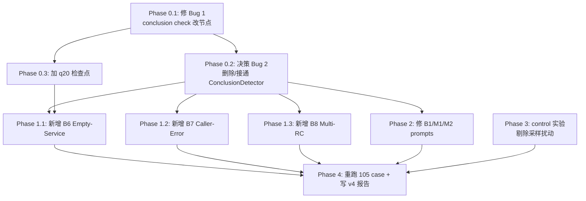

# 元认知中间件 v4 实施规划

> **来源**：从 [`MW-vs-w_o-MW.md`](../../analysis/4-middleware/MW-vs-w_o-MW.md) E 段提取。该报告基于 105 个 thinkdepthai-qwen3.5-plus-mw-v3 case 的逐 case 分析。
> **背景**：v3 翻正率 49/105 = 46.7%，存在 3 个 v3 已知 bug 和 5 个失败模式可改进。详见 [`CLAUDE.md`](CLAUDE.md) 的 "v3 已知 Bug" 和 "失败模式" 章节。
> **目标**：v4 翻正率 ≥ 60/105 = 57%（stretch goal 65%），零回归。
> **预计工时**：~5-6 working days

---

## 验收标准（Definition of Done）

| 指标 | v3 当前 | v4 目标 | v4 stretch goal |
|---|---|---|---|
| 总翻正率 | 49/105 = 46.7% | **≥ 60/105 = 57%** | 68/105 = 65% |
| Process advisor 平均承重率 | 27% | ≥ 35% | ≥ 45% |
| qpf<37 case 翻正率 | 21/44 = 48% (含 12 mysterious) | ≥ 25/44 = 57% | ≥ 30/44 = 68% |
| Conclusion check 内容可观测 | 否 (Bug 1) | **是** | — |
| ConclusionDetector 是否真的在跑 | 否 (Bug 2) | **是 或 删除** | — |
| 回归 case (不应有) | 0 | 0 | 0 |

**回归测试硬性要求**：v3 中已经翻正的 49 个 case，v4 中**不允许有任何一个回退为错**。如果出现回退，说明 v4 的某个改动引入了副作用，必须排查。49 个 case 列表见 [`MW-vs-w_o-MW.md` C.4 节](../../analysis/4-middleware/MW-vs-w_o-MW.md#c4-105-个-case-完整影响列表按-dataset_index-排序)。

---

## 执行顺序



| Phase | 估计时间 | 依赖 |
|---|---|---|
| Phase 0.1 (Bug 1 修复) | 0.5 day | — |
| Phase 0.2 (Bug 2 决策 + 实施) | 0.5 day | Phase 0.1 完成 |
| Phase 0.3 (q20 检查点) | 0.5 day | Phase 0.1 完成 |
| Phase 1.1 (B6) | 1 day | Phase 0 完成 |
| Phase 1.2 (B7) | 0.5 day | Phase 0 完成 |
| Phase 1.3 (B8) | 0.5 day | Phase 0 完成 |
| Phase 2.1-2.3 (修现有维度) | 0.5 day | Phase 0 完成 |
| Phase 3 (control 实验) | 1 day（含跑 3 次 105 case，每次约 4-6h） | 可与 Phase 1-2 并行 |
| Phase 4 (重跑 v4 + 写报告) | 1 day（rollout 4-6h + 分析 2h） | Phase 0-2 全部完成 |
| **总计** | **~5-6 working days** | — |

---

## Phase 0 — Bug 修复（必须，blocking 后续）

### Step 0.1 修 Bug 1：conclusion check 改成节点 (P0)

**问题**：`should_continue_mw` 在 LangGraph conditional edge 里 mutate state，conclusion 干预内容不可观测。

**改动**：
- 文件：[`agent_runner.py`](agent_runner.py)
- 删除 [`agent_runner.py:177-180`](agent_runner.py#L177-L180) 的 mutation
- 新增节点 `pre_conclusion_check_node`，return value 走正常 reducer
- 新增 conditional edge `after_pre_conclusion_check`
- 拆分 `should_continue_mw` 只做"有 tool_calls → tool_node / 无 → pre_conclusion_check"

**伪代码**：
```python
def pre_conclusion_check_node(state):
    intervention = pipeline.check_before_conclusion()
    if intervention:
        return {"researcher_messages": [HumanMessage(content=intervention)]}
    return {}

def after_pre_conclusion(state):
    last = state["researcher_messages"][-1]
    if isinstance(last, HumanMessage) and "Investigation Advisor" in last.content:
        return "llm_call"
    return "compress_research"

builder.add_node("pre_conclusion_check", pre_conclusion_check_node)
builder.add_conditional_edges("llm_call", should_continue_mw,
    {"tool_node": "tool_node", "pre_conclusion_check": "pre_conclusion_check"})
builder.add_conditional_edges("pre_conclusion_check", after_pre_conclusion,
    {"llm_call": "llm_call", "compress_research": "compress_research"})
```

**验证**：
1. 跑 1 个冒烟 case，检查 trajectory JSON 中包含 `[Investigation Advisor — Pre-Conclusion Review]` 的 user 角色消息
2. 重跑 105 个 case 后，[`mw_vs_womw_extract.py`](../../RCAgentEval/scripts/mw_vs_womw_extract.py) 应该不再依赖 loopback signature——直接用 role=user + 正则就能 100% 抓到 conclusion 干预
3. cache 文件中 `mw.advisors` 应该新增 `phase=conclusion` 的条目

**风险**：LangGraph 路由图变化可能影响 recursion_limit 计算（每个 case 多一个节点经过）。需要把 [`run_rca.py`](run_rca.py) 的 `recursion_limit` 从 300 改到 400 防止意外截断。

---

### Step 0.2 决策 Bug 2：删除或接通 ConclusionDetector (P0)

**问题**：`_run_conclusion_cycle` 是死代码——v3 的 `check_before_conclusion()` 直接返回硬编码的 9 项固定文本，从来不调用 L2 conclusion detector。

**两个选项**：

**选项 A — 接通**（推荐）：让 conclusion check 真的跑动态检测（M1/M2/M3/M4），而不是固定 9 项。
- 文件：[`pipeline.py`](pipeline.py)
- `check_before_conclusion()` 改为先调用 `_run_conclusion_cycle()` 拿动态检测结果，再降级到 `_CONCLUSION_PROMPT`
- **优点**：每个 case 的 conclusion 干预可以针对当前的反思状态定制
- **缺点**：每个 case 多 2-3 次 LLM 调用（成本上升）

**选项 B — 删除**：把 `_run_conclusion_cycle()` 和 `ConclusionDetector` 整个删掉，明确只用固定文本。
- **优点**：代码意图清晰，零额外成本
- **缺点**：失去了细分维度的能力

**建议**：先做选项 A，等 v4 跑完再评估每 case 的成本/收益，决定是否回退到 B。

**验证**：抽 5 个 wrong→correct 和 5 个 wrong→wrong 的 case，对比启用动态检测前后干预内容的差异。

---

### Step 0.3 加 query 20 早期检查点 (P1)

**问题**：42% case 在 q37 前就收敛，process 干预永远没机会触发。

**改动**：
- 文件：[`config.py`](config.py)
- `check_points: list[int] = field(default_factory=lambda: [20, 37, 44])`
- 同时把 `max_interventions` 从 3 加到 4 防止 q20 占用配额

**风险与缓解**：q20 时正确 case 也大量在跑（~95%），误伤率会高。**缓解**：让 q20 的检测器只用 B3、B5、B6（新增）这三个高承重维度，不跑 B1/M1（B1 在 q20 时几乎都会误报）。

```python
# config.py 新增
EARLY_CHECK_DEFICIENCIES = {"B3", "B5", "B6"}  # only these fire at q20
LATE_CHECK_DEFICIENCIES = {"B1", "B2", "B3", "B5", "M1", "M2"}  # full set at q37/q44
```

[`process_detector.py`](deficiency_detector.py) 根据当前 query_count 选择 active set。

**验证**：105 case 重跑后，统计 q20 检查点的触发数和误伤数（误伤 = 在已正确 case 上触发）。

---

## Phase 1 — 新增检测维度 (P1)

### Step 1.1 新增 B6: Empty-Service Hypothesis

**位置**：[`deficiency_detector.py`](deficiency_detector.py)
- 在 `PROCESS_DEFICIENCIES` 字典中加入 B6
- 在 `EARLY_CHECK_DEFICIENCIES` 也加入 B6（这是 q20 时主力检测维度）

**检测条件**：扫描最近 5 条 think_tool reflection 拼接成字符串，匹配以下模式中的任意一个：
```python
EMPTY_SERVICE_PATTERNS = [
    r"missing\s+from\s+abnormal_traces",
    r"no\s+(?:logs?|traces?|spans?)\s+(?:in|during)\s+abnormal",
    r"(?:metric|metrics?)\s+(?:is|are)\s+NaN",
    r"completely\s+unavailable",
    r"disappeared\s+(?:from|during)",
    r"empty\s+(?:in|during)\s+abnormal",
]
```
如果命中且最近 reflection 中包含 "root cause" 类断言指向同一服务 → 触发 B6。

**Prompt 模板**（替换抽象的 M3）：
```
You're treating the absence of trace/log/metric data for service X as evidence
that X is the root cause. But absence has multiple explanations:
1. X is healthy and outside the failing call chain (most likely)
2. X crashed entirely and stopped emitting telemetry (less common)
3. X was never on this request path

Before concluding X is the root cause, find at least one POSITIVE signal of X's failure
(a log entry, a metric anomaly, a span with error status). If no such signal exists,
X is probably not the root cause.
```

**回归测试 case**（必须翻正才算成功）：341, 1934, 2211, 2258, 1371, 3776, 4081, 832, 2716, 4258 — **共 10 个**

**预期收益**：10 个 case 中 5 个翻正（50% 回归测试通过率即合格）

---

### Step 1.2 新增 B7: Caller-Error Misattribution

**位置**：同上

**检测条件**：扫描最近 5 条 reflection，匹配 `(\w+).*calling.*(\w+).*(?:refused|503|reset|error)` 类正则，并且 agent 当前推测的 root cause 是 group 1 而非 group 2。

```python
CALLER_ERROR_RE = re.compile(
    r"(ts-[\w-]+).*?(?:call|calling|->|-->)\s*(ts-[\w-]+).*?"
    r"(?:Connection refused|503|reset|timeout)",
    re.IGNORECASE,
)

def detect_b7(reasoning_log, current_rc_candidate):
    for refl in reasoning_log[-5:]:
        m = CALLER_ERROR_RE.search(refl)
        if m and current_rc_candidate == m.group(1) and m.group(2) != current_rc_candidate:
            return True, f"You see {m.group(1)} → {m.group(2)} with error, but {m.group(2)} is more likely source"
    return False, None
```

**Prompt 模板**：
```
You're attributing the failure to X because you see "X calls Y, X gets Connection refused/503".
But Connection refused / HTTP 503 is generated by the CALLEE refusing the request,
not the caller. Y is more likely the root cause unless you can show:
1. Y is healthy AND
2. X has its own independent failure (not caused by Y's response)
```

**回归测试 case**：33, 247, 579, 1218, 2231, 2598, 4519, 4732, 1195 — **共 9 个**

**预期收益**：9 个 case 中 4-5 个翻正

---

### Step 1.3 新增 B8: Multi-RC Overcorrection

**位置**：同上，但放进 LATE_CHECK_DEFICIENCIES（q37 之后才触发）

**检测条件**：当 agent 在最近 think_tool reflection 中明确列出 ≥2 个候选 root cause 服务时。

```python
MULTI_RC_RE = re.compile(
    r"Root\s+Cause(?:s)?:\s*\n?\s*1\.\s*(ts-[\w-]+)\s*\n?\s*2\.\s*(ts-[\w-]+)",
    re.IGNORECASE,
)
```

**Prompt 模板**：
```
You've listed multiple services as root causes, but a fault injection typically
has a single origin. Among your candidates, ask: which one would still be anomalous
if the others were healthy? That's the upstream-most cause.

Eliminate the rest as downstream propagation by checking if their anomalies
disappear in a hypothetical scenario where the candidate cause is removed.
```

**回归测试 case**：1195, 3868, 1394, 1371, 3776, 1917 — **共 6 个**（注意 2682 已经部分翻正，不算回归用）

**预期收益**：6 个 case 中 3-4 个翻正（多 RC 收敛比 caller-error 更难，agent 已经"列出多个"通常意味着已经看过证据）

---

## Phase 2 — 修改现有维度 (P2)

### Step 2.1 B1 检测器排除 baseline 类意图

**位置**：[`deficiency_detector.py`](deficiency_detector.py) 的 `ProcessDetector.detect()` 中 B1 检测路径

**改动**：B1 检测 "10 consecutive unknown intents" 时，过滤掉 `baseline_collect/baseline_contrast/discovery`：
```python
def b1_filter(intent):
    return intent not in ("baseline_collect", "baseline_contrast", "discovery")
```

**回归测试**：case 1495 (B3↔B1 自循环)、3393、4258、4055、4707。这些 case 不应该再因为做了 baseline 对比就触发 B1。

**验证**：105 case 重跑后，B1 触发次数应该从 32 降到 ~25，B3 承重的 case 数应该上升。

---

### Step 2.2 M2 prompt 改成提问式

**位置**：[`deficiency_detector.py`](deficiency_detector.py) 的 `M2.check_question`

**改动**：把当前断言式改成提问式
```python
# 旧
"The agent gravitates toward shared infrastructure ... When multiple services share..."

# 新
"Is the agent gravitating toward a shared infrastructure component (DB/MQ/gateway) "
"as root cause? Before accepting this, ask: are the same shared component errors "
"present in the BASELINE/normal period? If yes, they're noise rather than incident-related. "
"Has the agent compared baseline vs abnormal for this shared component yet?"
```

**回归测试**：case 2231（被 M2 推到完全不相干服务）和 case 755 应该从 misdirected 变为 correct 或 still wrong（不应该再是"反应过度"）。

---

### Step 2.3 M1 prompt 改成具体反例追问

**位置**：同上

**改动**：替换 M1 的 `check_question`
```python
# 旧
"If the agent found anomalies in >3 services, has it reasoned about causal relationships..."

# 新
"You see anomalies in services [list]. For your top candidate root cause C, ask explicitly:
1. If C were removed/healthy, would the other anomalies still occur?
2. Is there any service whose anomaly came BEFORE C's first error?
3. Did you check whether C is being called by another service that's failing?
Don't just enumerate anomalies — pick one and run this elimination test."
```

**回归测试**：case 247, 1459, 2598, 1195, 3868, 4353

---

## Phase 3 — 实验设计：剔除采样扰动 (P0 analysis)

**问题**：12 个 wrong→correct 的 rewrite-mysterious case 不能算 MW 真实增益。这 12 个 case 是：130, 832, 864, 1435, 2641, 3138, 3552, 4070, 4311, 4519, 4530, 4841

**实验设计**：
1. 跑一个新的 exp_id `thinkdepthai-qwen3.5-plus-control-v1`：和 baseline 完全相同的代码、prompt、模型，**唯一区别是固定随机种子或 temperature=0**
2. 跑 3 次重复实验，统计 105 个 case 的方差
3. 如果 12 个 rewrite-mysterious case 中超过 8 个在 control 实验中也翻正了 → 确认是采样扰动
4. 如果 control 实验只翻正 2-3 个 → 说明 MW 的 background L1 LLM 调用确实有副作用，需要进一步研究

**输出**：一个新的报告 `MW_rewrite_mysterious_control.md`，决定 v4 真实救回率应该按 49 还是 37 算。

---

## Phase 4 — 重跑验证

完成 Phase 0-2 后，重跑全 105 个 case：

```bash
cd /home/nn/SOTA-agents/Deep_Research
ENABLE_MIDDLEWARE=1 EXP_ID="thinkdepthai-qwen3.5-plus-mw-v4" \
    uv run python ../RolloutRunner/scripts/run_rollout.py \
    --agent thinkdepthai \
    --source_exp_id thinkdepthai-qwen3.5-plus-mw-v3
```

然后用 [`mw-trajectory-analysis` skill](../../.claude/skills/mw-trajectory-analysis/SKILL.md) 重新跑分析：

```bash
cd /home/nn/SOTA-agents/RCAgentEval
# 改 mw_vs_womw_extract.py 的 MW_EXP 常量为 v4
uv run python scripts/mw_vs_womw_extract.py
# 重新生成 cache，用 SKILL 写一份 MW_v4_vs_v3.md 报告
```

---

## 风险与回滚

| 风险 | 缓解 | 回滚动作 |
|---|---|---|
| Bug 1 修复后 LangGraph 路由边 case 出错 | 先在 1 个 case 上跑冒烟测试 | 回到 v3 mutation 写法（已有备份） |
| q20 检查点误伤大量正确 case 导致总翻正率反而下降 | 限制 q20 时只用 B3/B5/B6 三个高承重维度 | `MW_CHECK_POINTS=37,44` 环境变量回退 |
| B6/B7/B8 prompt 触发率过高，干预上限 (4) 用尽 | 跑 5 个冒烟 case 看每 case 平均干预次数 | 收紧检测正则 |
| Phase 4 重跑发现 MW v4 比 v3 还差 | 必须立即回滚并定位是哪个 Phase 引入的副作用 | git revert + 单独跑每个 Phase |
| Control 实验显示 12 个 mysterious case 不是采样扰动 | 接受 v4 真实救回率按 49 算，但需要研究 L1 分类器副作用 | — |

---

## 结果发布与文档同步

完成 v4 后必须更新的位置：

1. [`Deep_Research/middleware/CLAUDE.md`](CLAUDE.md) — 添加 v4 章节，记录 v3→v4 的所有变更
2. [`.claude/skills/mw-trajectory-analysis/SKILL.md`](../../.claude/skills/mw-trajectory-analysis/SKILL.md) — 更新"已知 v3 bug"那一段，移除已修的 bug
3. [`Deep_Research/middleware/CHANGELOG.md`](CHANGELOG.md) (新建) — v4 变更日志
4. [`MW-vs-w_o-MW.md`](../../analysis/4-middleware/MW-vs-w_o-MW.md) — 增补一个"v4 vs v3 对比"小节

---

## 完成 v4 后的下一步预想

**如果 v4 翻正率 ≥ 60**：
- 考虑把 v4 的最终配置作为 thinkdepthai 的默认 MW 配置
- 跨 model 验证：在 doubao-seed / kimi-k2 / claude-sonnet 上跑同一套 v4，看是否模型相关
- 跨 framework 验证：把核心 B/M 检测逻辑提取成 framework-agnostic 库，测试是否能用在 deer-flow-v2、aiq 等其他 agent 上

**如果 v4 翻正率 < 55**：
- 说明 R5/R6 锚定问题主导，需要从 prompt 层面之外解决（比如限制 agent 一旦定下某服务为候选就强制做反例验证）
- 或者重新评估 qwen3.5-plus 的 instruction-following 极限——可能某些失败是模型本身能力天花板

---

## 引用：v3 失败模式回顾

详细分析见 [`MW-vs-w_o-MW.md`](../../analysis/4-middleware/MW-vs-w_o-MW.md) D 段。这里只列出每条改进对应解决的失败模式：

| v4 改进 | 对应 v3 失败模式 | 影响 case 数 |
|---|---|---|
| Bug 1 修复 | conclusion 干预内容不可审计 | 全 105 case 都受影响 |
| Bug 2 决策 | M1/M2/M3/M4 conclusion-time 检测从未运行 | 全 105 case 都受影响 |
| q20 检查点 | qpf<37 case process 干预无机会触发 | 44 个 case，目前 21 翻正 |
| **B6** Empty-Service | M3 沉默非健康，"消失即根因"反模式 | 10 个 (341, 1934, 2211, 2258, 1371, 3776, 4081, 832, 2716, 4258) |
| **B7** Caller-Error | R5 因果倒置，"caller 报错就归因 caller" | 9 个 (33, 247, 579, 1218, 2231, 2598, 4519, 4732, 1195) |
| **B8** Multi-RC | agent 列出多个 RC 而不是收敛到 1 个 | 6 个 (1195, 3868, 1394, 1371, 3776, 1917) |
| B1 排除 baseline 自循环 | B3 触发后 B1 又开火，相互打架 | case 1495, 3393, 4258, 4055, 4707 |
| M2 改提问式 | M2 替 agent 排除 RabbitMQ 后反应过度 | case 2231, 755 |
| M1 改反例追问 | M1 prompt 太抽象 agent 无法转化为行动 | case 247, 1459, 2598, 1195, 3868, 4353 |
